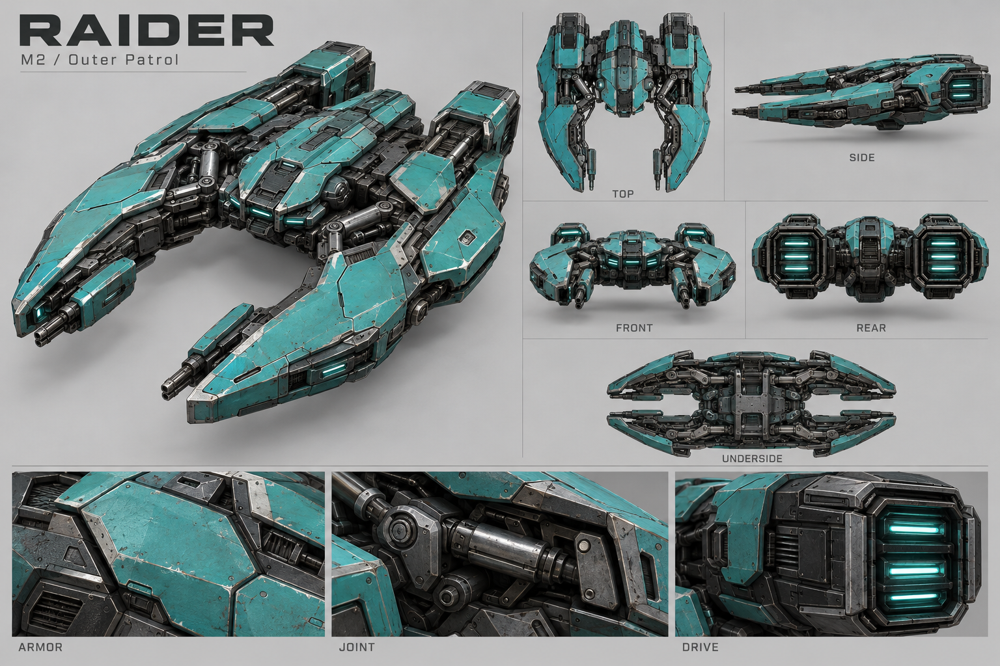
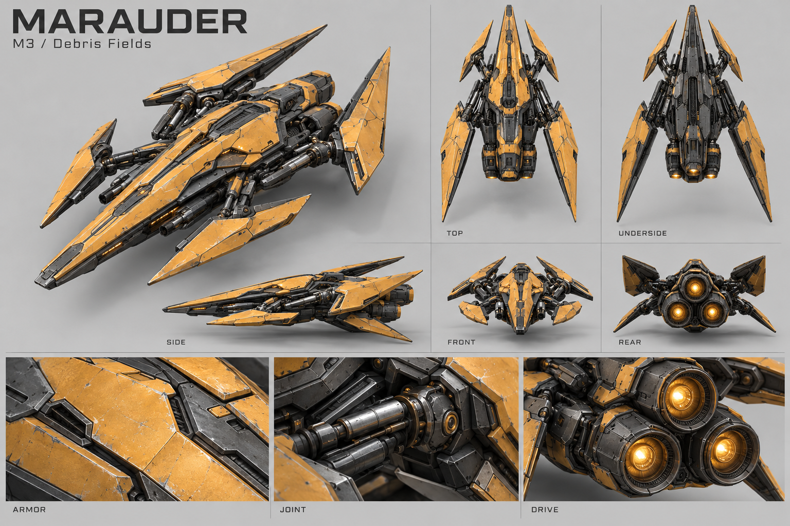

# M2, M3 and M4 alien modeling references

Generated with the built-in image generation tool on 12 October 2026.
These six proposed concept sheets cover the existing outer-sector roster.
They await user art review. The exact [prompts](prompts.json) are retained;
no input reference images were supplied to the generator.

| Map | Alien | Reference sheet | Proposed modeling direction | Existing accent |
| --- | --- | --- | --- | --- |
| M2 / Outer Patrol | Skirmisher | [Skirmisher](skirmisher.png) | Slim needle hull, swept scythe wings, exposed hydraulic connections and two compact rear drives. | Mint `#74e6b2` |
| M2 / Outer Patrol | Raider | [Raider](raider.png) | Broad split-pincer hull, deep open nose, low armored shoulders and two rectangular drives. | Teal `#37bdb8` |
| M3 / Debris Fields | Marauder | [Marauder](marauder.png) | Long armored prow, four staggered blade outriggers and a triangular cluster of three drives. | Amber `#ffc36e` |
| M3 / Debris Fields | Warden | [Warden](warden.png) | Blunt shield-like prow, raised layered carapace, short lateral armor shields and a deep belly. | Coral `#ee7954` |
| M4 / Frontier | Ravager | [Ravager](ravager.png) | Segmented spear hull, forward-swept raptor blades and reinforced blade collars. | Violet `#b788fa` |
| M4 / Frontier | Overlord | [Overlord](overlord.png) | Broad diamond hull, tiered dorsal command armor, twin weapon sponsons and stacked rear drives. | Magenta `#ed70c1` |

Colors and map membership follow [Alien.TYPES](../../../../scripts/alien.gd)
and [SectorMaps.MAPS](../../../../scripts/sector_maps.gd). Shapes are proposals
for this art pass, with increasing armor mass toward the stronger encounters.

Each sheet has a large perspective concept, top, side, front, rear and underside
views, plus armor, joint and drive close-ups. The finish follows the existing
M1 art vocabulary: interlocking colored plating, gunmetal structure, machined
trim, recessed sensors and exhausts, exposed mechanisms and restrained wear.

## Using the sheets

Use the large perspective view as the primary shape and material reference.
Generated secondary views are approximate and sometimes conflict in wing
orientation, weapon details, drive arrangement or panel shapes. They are not
calibrated orthographic drawings. Resolve each craft into one connected,
bilaterally symmetric editable mesh, then render consistent construction views
from that model. The sheets establish no physical dimensions or gameplay scale.

In particular, the Raider's and Overlord's underside views are rotated relative
to their top views, and the Warden's top and underside face opposite directions.
The Ravager shows exhaust-like openings facing forward in its perspective and
front views; author its propulsion at the rear and resolve the central exhaust
and blade sweep against the intended spear silhouette. Use the Overlord rear
view to guide its four-drive arrangement; its side view suggests an extra drive
tier that should not be carried into the mesh. Simplify ambiguous small recesses
when authoring each craft.

The three close-ups guide materials and construction. They are not seamless
textures or UV-ready PBR maps. Author base color without baked studio lighting,
keep sensor and drive glow in emission, and model major silhouette features,
armor gaps and joint assemblies as geometry. Fine grain and wear belong in the
surface maps.

The existing `art/.gdignore` excludes these source references from Godot imports.
This collection contains generated concepts, not editable models or actual
mesh renders. The six types continue using their current procedural game
visuals. Existing M1 models and the game's combat, collision and size settings
are unaffected.

## Gallery

### M2 / Outer Patrol

### M3 / Debris Fields

### M4 / Frontier

