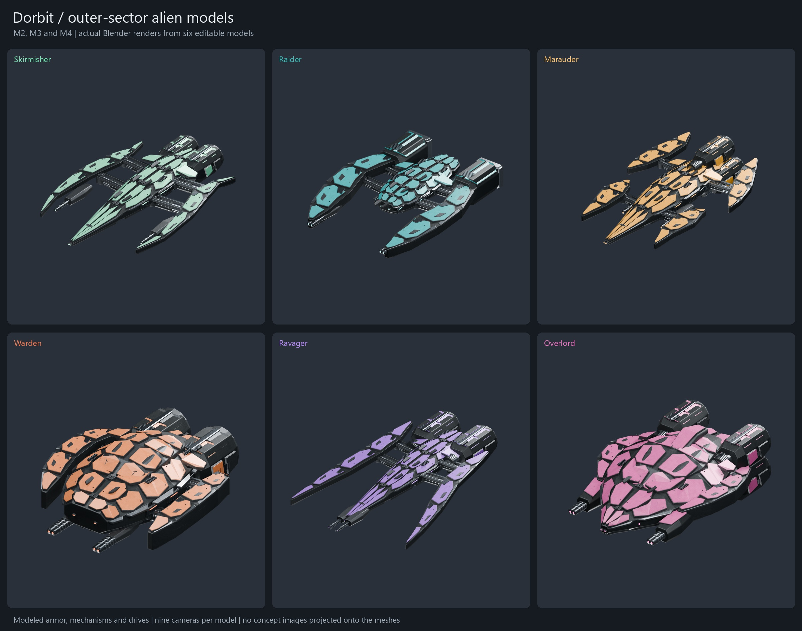
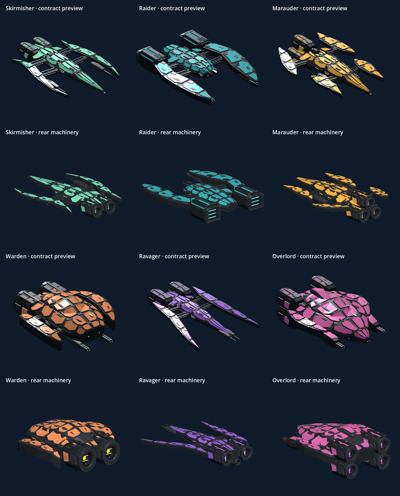

# Outer-sector alien models

Art sources and review images use [Git LFS](https://git-lfs.com). Before editing
art sources or running art tools, install Git LFS and run `git lfs install` and
`git lfs pull` from the repository root.

Six editable Blender models built from the [approved M2–M4 references](../concepts/outer-sectors/README.md).
The gallery below contains actual renders of the saved meshes.



| Alien | Blender source | Portable GLB | Construction views | Details | Reference comparison |
| --- | --- | --- | --- | --- | --- |
| Skirmisher | [Model](models/skirmisher.blend) | [GLB](exports/skirmisher.glb) | [Six views](previews/skirmisher-views.jpg) | [Close-ups](previews/skirmisher-details.jpg) | [Compare](previews/skirmisher-comparison.jpg) |
| Raider | [Model](models/raider.blend) | [GLB](exports/raider.glb) | [Six views](previews/raider-views.jpg) | [Close-ups](previews/raider-details.jpg) | [Compare](previews/raider-comparison.jpg) |
| Marauder | [Model](models/marauder.blend) | [GLB](exports/marauder.glb) | [Six views](previews/marauder-views.jpg) | [Close-ups](previews/marauder-details.jpg) | [Compare](previews/marauder-comparison.jpg) |
| Warden | [Model](models/warden.blend) | [GLB](exports/warden.glb) | [Six views](previews/warden-views.jpg) | [Close-ups](previews/warden-details.jpg) | [Compare](previews/warden-comparison.jpg) |
| Ravager | [Model](models/ravager.blend) | [GLB](exports/ravager.glb) | [Six views](previews/ravager-views.jpg) | [Close-ups](previews/ravager-details.jpg) | [Compare](previews/ravager-comparison.jpg) |
| Overlord | [Model](models/overlord.blend) | [GLB](exports/overlord.glb) | [Six views](previews/overlord-views.jpg) | [Close-ups](previews/overlord-details.jpg) | [Compare](previews/overlord-comparison.jpg) |

Skirmisher has a narrow mint needle hull, curved scythes and twin drives.
Raider has a deep open pincer nose and two rectangular exhaust grilles.
Marauder has four staggered blade outriggers and three drives in a triangle.
Warden has a blunt shield prow, thick lateral shields and a raised carapace.
Ravager has a split spear nose, long forward-swept blades and aft violet turbines.
Overlord has a broad diamond hull, tiered command armor, paired weapon sponsons
and exactly four rear drives in two stacked pairs.

The large concept perspective guides the silhouettes and finishes. The secondary
generated views disagree in places. Propulsion consistently faces aft, the
Overlord side-view extra drive tier is omitted, and the Raider and Warden
construction views use a consistent nose direction. The models interpret the
references rather than reproduce every generated fitting or surface mark.

## Source and runtime assets

Each `.blend` opens with its perspective camera active. F12 renders that view.
Six construction cameras and three detail cameras share the same editable
geometry. Collections separate the keel and armor, outriggers, hydraulic forks,
propulsion, weapons, service fittings and studio. The reference image is packed
in a hidden collection. Three packed 4096 × 4096 maps provide sRGB albedo,
roughness/metallic channels and tangent-space normals. Wear follows the actual
plate outlines. Sensors and exhausts use separate emissive material surfaces.
Concept images are never projected onto the meshes.

Review units use -Y forward and +Z up. The review GLBs contain one mesh with
seven material surfaces and three embedded maps, with reduced bevel segments.
Studio cameras, lights and reference objects are excluded.

Derived [runtime exports](../../../assets/aliens) replace the six procedural
placeholders in flight and shared previews. They use -Z forward, +Y up,
three shared 2K maps and Godot-generated distance LODs. Their bounding diameters
match the measured previous placeholders before the existing presentation scale.
The 2.2 m collision spheres, combat values and encounter populations retain their
settings. Server-only aliens create no visual meshes. Shield and destruction
effects use the recorded visual diameters without loading models on the server.
The existing three M1 source models and GLBs are retained.
Outer-sector coated armor uses a 0.35 emission lift for visibility in shadow;
the M1 visibility finish remains at 2.0. This keeps orange and amber armor
distinct in the Compatibility renderer.



[Fixed-distance sector lighting at 25 m and 90 m](previews/godot-sector.png).

## Rebuild

From the repository root, using Blender 5.2.2 LTS:

```powershell
rtk proxy blender --background --factory-startup --python-exit-code 1 --python art/alien-review/outer-sectors/build_models.py
rtk proxy blender --background --factory-startup --python-exit-code 1 --python art/alien-review/outer-sectors/validate_models.py
rtk proxy blender --background --factory-startup --python-exit-code 1 --python tools/export_aliens.py -- --outer
rtk proxy py -3.13 art/alien-review/outer-sectors/build_review_sheets.py
```

Use the full Blender executable path when it is not on PATH. The sheet composer
needs Pillow, installed into `.tools/art-python` as in the [M1 instructions](../README.md).
Append `-- Skirmisher --draft` to the builder for small shape studies.
Drafts overwrite that model's render and material outputs, so finish with a full
build before validation or export. A full build always saves the packed source
before rendering. Selected names without `--draft` rebuild final assets.

[Source validation](validation.json) checks reopened files, finite geometry,
UVs, packed maps, camera renders and GLB round trips, including visibility of
all sixteen recessed exhaust centers. [Render validation](render-validation.json)
checks all 54 images for nonempty content and full-view boundary clearance.
[Build statistics](build-stats.json) record component and triangle counts.
The runtime exporter updates [export statistics](../../../assets/aliens/export-stats.json).

After Godot import, `tests/alien_assets_test.gd` exercises every alien's materials,
orientation, LODs, shared previews, size, collision, combat tuning and respawn.
`tools/render_alien_preview.gd -- --outer` captures the six models in Godot;
add `--sector` for fixed-distance sector lighting comparisons.
Representative multiplayer hardware still needs performance playtesting.
