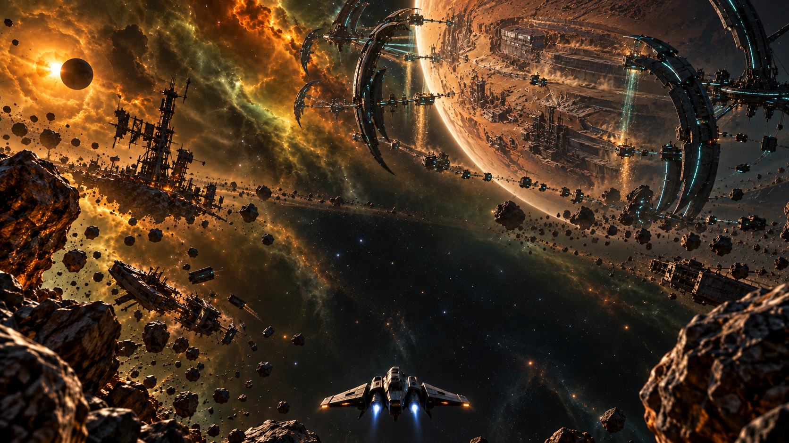

# Map background concepts

Four original environment references for Dorbit's existing sectors, generated and revised with the built-in image generation tool on 2026-10-12. The v2 images below follow the reclamation story in [PR #76](https://github.com/Timerk/Dorbit/pull/76) and the user's request for evidence of former inhabitants, war damage and alien resource extraction. Each preserves the first pass's behind-the-ship camera, sector palette and darker central flight area.

| Sector | Direction | Image |
| --- | --- | --- |
| M1 / Outpost 01 | Bombarded human cities, shattered orbital defenses and a returning outpost under construction | [Full image](m1-outpost-01-v2.png) |
| M2 / Outer Patrol | Alien planetary collectors over excavation scars, with ruined human settlements and patrol infrastructure | [Full image](m2-outer-patrol-v2.png) |
| M3 / Debris Fields | Alien salvage machinery stripping a human carrier, damaged receivers and moon extraction | [Full image](m3-debris-fields-v2.png) |
| M4 / Frontier | Alien extraction complex grafted onto a ruined human orbital ring | [Full image](m4-frontier-v2.png) |

See the [campaign art direction](campaign-direction.md), [DarkOrbit research and official reference links](../../docs/research/darkorbit-map-backgrounds.md), [revision prompts](campaign-prompts.md) and [original prompts](prompts.md).

The first pass remains available for comparison: [M1](m1-outpost-01.png), [M2](m2-outer-patrol.png), [M3](m3-debris-fields.png) and [M4](m4-frontier.png).

These single-view paintings are the approved art references. The game now implements their sector palettes, damaged colony worlds, human ruins and alien extraction machinery as procedural 3D scenery. See the [in-game review and validation](../../docs/sector-art/campaign-backgrounds.md). The concept paintings remain separate from runtime assets; existing player ships and Outpost 01 retain their models. The `.gdignore` file keeps this review directory out of Godot's asset import.
