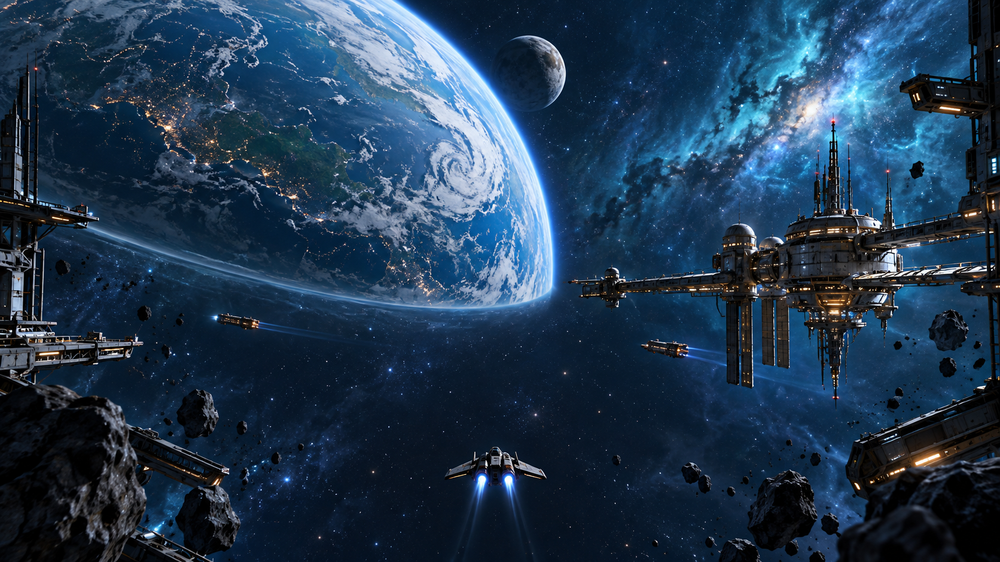
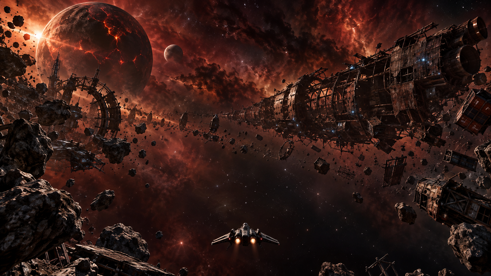
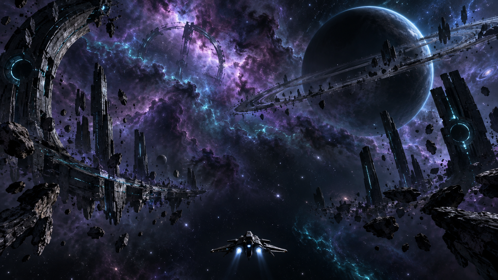

# Map background concepts

Four original environment references for Dorbit's existing sectors, generated with the built-in image generation tool on 2026-10-12. Each uses a behind-the-ship camera and separates detailed scenery around the edges from darker space in the central flight direction.

| Sector | Direction | Image |
| --- | --- | --- |
| M1 / Outpost 01 | Blue inhabited planet, working orbital station and traffic | [Full image](m1-outpost-01.png) |
| M2 / Outer Patrol | Amber desert planet, asteroid belt, patrol relay and distant gate | [Full image](m2-outer-patrol.png) |
| M3 / Debris Fields | Red dust, scarred moon and broken industrial carrier | [Full image](m3-debris-fields.png) |
| M4 / Frontier | Violet nebula, dark ringed planet and unfamiliar alien ruins | [Full image](m4-frontier.png) |

See the [DarkOrbit research and official reference links](../../docs/research/darkorbit-map-backgrounds.md) and [complete generation prompts](prompts.md).

These single-view paintings guide a possible redesign. They are not seamless skyboxes or runtime assets. A 3D implementation still needs scenery in other viewing directions, lighting and combat readability checks, and performance measurements. The ships and structures in these images demonstrate composition and scale; they do not replace existing game models. No gameplay or game-plan changes are included. The `.gdignore` file keeps this review directory out of Godot's asset import.
