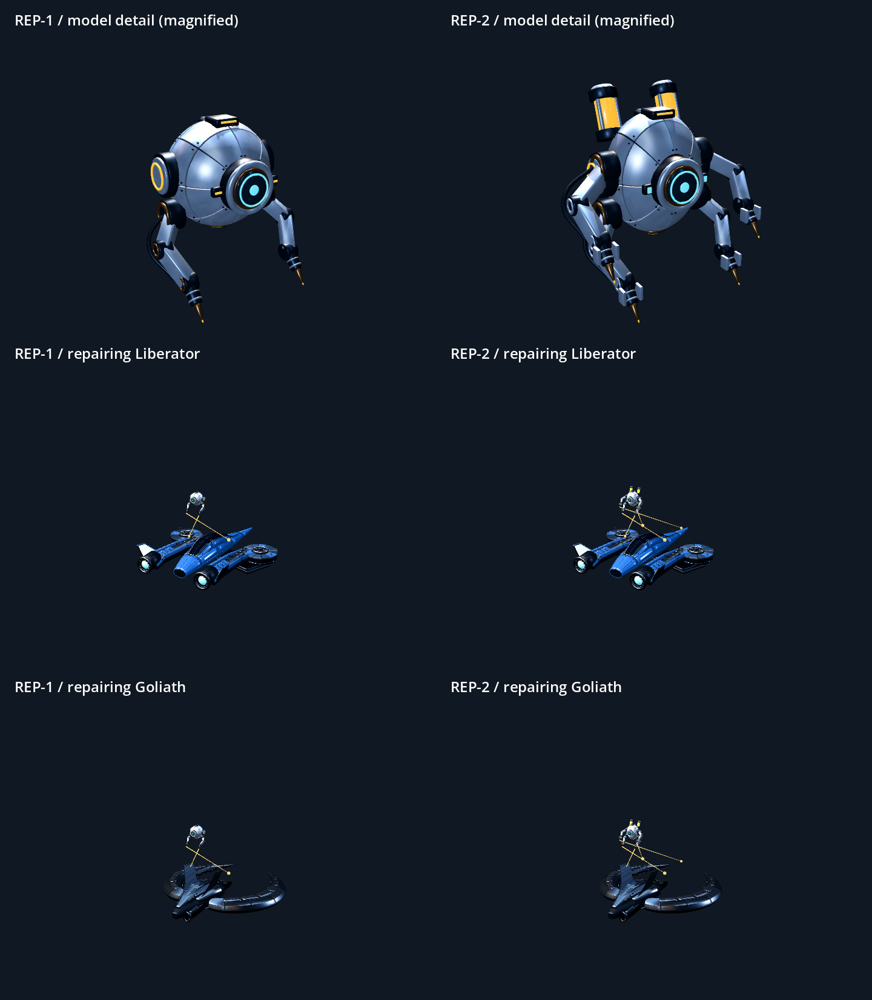

# Repair robot models

The existing original `assets/ui/extras/rep-1.png` and `rep-2.png` illustrations
guide these two flight models. REP-1 has a spherical silver shell, large cyan
sensor, copper joints and two welding arms. REP-2 has a taller plated shell,
four tool arms, grippers and two amber power canisters. Curved armor seams,
mechanical hubs, hydraulic pistons, cables, radiator fins and precision nozzles
are modeled geometry; brushed silver uses a small packed surface texture.



`rep-1.blend` and `rep-2.blend` are editable sources outside Godot's imports.
`assets/extras/*.glb` are portable game exports facing -Z with +Y up. Each export
has one mesh and six material surfaces, plus named `ToolTip0` through `ToolTip1`
or `ToolTip3` attachment points. Godot generates distance LODs on import.

Regenerate with Blender:

```text
blender --background --python tools/build_repair_bots.py
```

Import with the project's pinned Godot editor, then capture a model/repair sheet:

```text
godot --headless --path . --editor --import
godot --path . --script res://tools/render_repair_bot_preview.gd
```

The sheet is saved to `build/validation/repair-bots-godot.png`. The top row is
magnified model detail; the lower rows use the actual Pilot and RepairBotVisual
over Liberator and Goliath hulls, including tool-tip beams. Both bots deploy at
30% of their authored size, 70% smaller in each dimension than the first review,
and hover closer to the hull. Phoenix retains its additional half-size scaling.
`tests/extras_test.gd` exercises authoritative activation/interruption,
both fitted tiers on local and remote clients, and dedicated-server exclusion.
Final art, hover clearance and size remain subject to player review.
