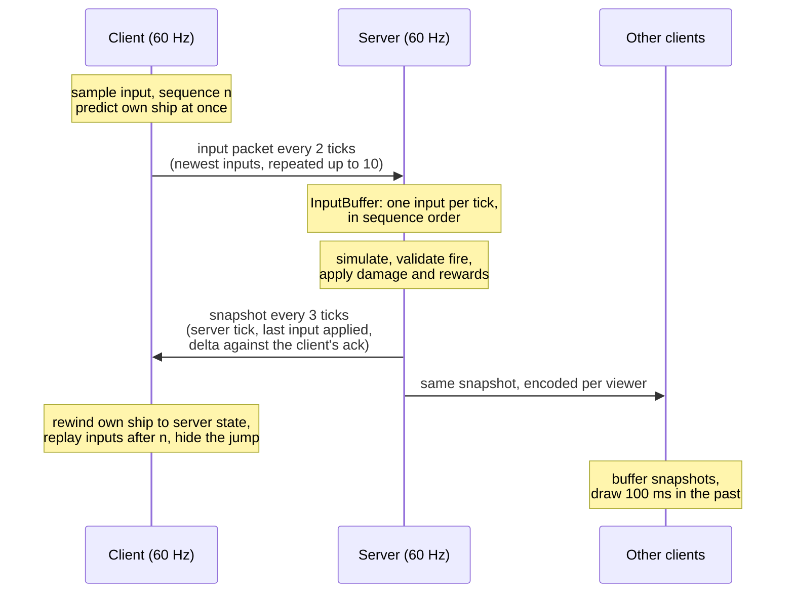

# Dorbit netcode

Dorbit is a multiplayer space game built in Godot 4.7.2. Up to ten pilots fly
and fight on a dedicated, authoritative Linux server, and Windows clients
connect to it over ENet. This document describes how movement reaches the
server and comes back, why it was rebuilt, and what the rebuild measured.

The rework ran as six stacked pull requests. Each one was measured with the
same benchmark before and after. The full measurement record, with every
condition and metric definition, is in [netcode-baseline.md](netcode-baseline.md).
The plan and its agreed scope are in the
[game plan](../GAME_PLAN.md#real-time-netcode-rework).

## Results

All rows use the same headless relay benchmark on one Windows desktop, or the
CI playthrough where noted. *Before* is the build just before the phase that
changed that row; *after* is the current build (network schema 26).

| What | Condition | Before | After |
| --- | --- | ---: | ---: |
| Flight inputs that never reach the server | 200 ms RTT, 5% loss | 25.3% | 0% |
| Flight inputs that never reach the server | 150 ± 30 ms RTT, 5% loss, CI | not measured | 0 of about 6,500 applied per run |
| Snapshots ENet discarded before sending | 200 ms RTT, no loss | up to half | none |
| Server traffic per client, four pilots | 150 ± 30 ms RTT, 5% loss | 14.4 KB/s | 5.2 KB/s (−64%) |
| Server traffic per client, ten pilots and five aliens | 20 snapshots/s | 22.5 KB/s | 6.7 KB/s (−70%) |
| Remote ship acceleration p95, drawn | 150 ± 30 ms RTT, 5% loss | 2,999 m/s² | 118 m/s² |
| Ticks where a remote ship visibly jerks | 150 ± 30 ms RTT, 5% loss | 83.9% | 3.6% |
| Local controls | any latency | dragged back toward a round-trip-old position | respond in the same frame |
| Reconciliation error p95 | 150 ± 30 ms RTT, 5% loss, CI | not measured | 0.00 m |

The cost: each client now uploads about 3.5 KB/s instead of 1.1 KB/s, because
every input packet repeats recent inputs. Remote ships are drawn about 100 ms
further in the past than the newest snapshot, so the interpolation always has
two samples to blend between.

## Try it

1. Turn on **Route connections through the network simulator (debug)** in the
   Graphics settings tab, or launch with `--netsim`. Optional starting
   conditions: `--netsim-rtt=150 --netsim-jitter=30 --netsim-loss=5`.
2. Connect to a server. The relay applies to the next connection.
3. Press **F8**. The overlay shows round-trip time, bytes per second in each
   direction, snapshot jitter, the server's input buffer, lost and late inputs,
   the latest and largest correction, interpolation buffer depth and
   extrapolation. Its sliders change latency, jitter, loss and duplication live.
   It can also draw a translucent ghost of your ship at the server's position.

The benchmark that produced the tables runs headless:

```
godot --headless --path . --script res://tests/netcode_benchmark.gd -- --scenario=baseline
godot --headless --path . --script res://tests/netcode_benchmark.gd -- --scenario=degraded
```

## Architecture

The server simulates everything at 60 Hz and is the only side that decides
positions, hits, damage, deaths, rewards and wallets. Clients send *intent*:
movement, boost, the facing they want and which target they are firing at.
They predict their own ship from that intent, and draw everyone else from
buffered server snapshots.



### Inputs: client to server

[`FlightInput`](../scripts/flight_input.gd) packs one input per 60 Hz client
tick: a sequence number, the client tick, movement on three axes, boost, and
the requested yaw and pitch. Movement and facing are quantized before the
client predicts with them, so client and server simulate the same numbers.

The client sends a packet every second tick (30 per second). Each packet
repeats up to ten unacknowledged inputs, so one input travels in up to five
packets and a burst of four lost packets costs nothing. Packets are
unreliable; redundancy does the work that resends would otherwise do, without
waiting a round trip.

On the server, each pilot has an [`InputBuffer`](../scripts/input_buffer.gd).
It discards duplicates and consumes exactly one input per server tick, in
sequence order:

- **Starved tick.** If no input has arrived yet, the tick reuses the last one
  without advancing the sequence. The buffer then holds one more input than
  before, so it grows on its own to absorb the jitter it sees. After 0.5 s
  without input the ship is treated as idle and brakes.
- **Catch-up.** If the buffer has held more than two spare inputs for a full
  2 s window, the surplus is dropped, which keeps the added input delay
  bounded. More than 12 buffered inputs (200 ms) are dropped at once.
- **Counters.** Applied, duplicate, late, lost (a sequence gap that was
  skipped), dropped and starved counts are kept per pilot. The F8 overlay and
  the CI tests read them.

The server never accepts a position or velocity from a client. Facing changes
are limited to 720° per second, and every input packet names the ship's
life, so an input from before a respawn cannot steer the new ship.

### Prediction and reconciliation: the local ship

[`FlightPrediction`](../scripts/flight_prediction.gd) simulates each input
immediately with `Pilot.simulate_input()`, the same step the server runs for
each consumed input. The input is kept until the server acknowledges it.

Each snapshot tells its owner which input sequence the server applied last.
When one arrives, the client:

1. drops every input up to that sequence;
2. resets the ship's position, velocity, energy, facing and turn budget to the
   server's values;
3. replays the remaining inputs in the same physics tick.

If client and server simulated the same inputs, the replay lands exactly where
the prediction was, and nothing moves. When they differ, the simulation jumps
to the corrected position, but the model and camera don't. They are drawn at
a world-space offset from the simulated ship that decays with a 0.12 s time
constant, hiding 95% of a correction in about 0.36 s. Corrections over 10 m
snap instead. The camera's view direction is never replayed, so mouse
steering stays immediate.

In practice the replay matches the server to within float rounding. The
corrections that remain come from the input buffer policy: a starved tick or
a catch-up drop shifts the server by one tick of motion, 0.5–1.4 m at cruise
speed.

### Interpolation: everyone else

Remote pilots and aliens are drawn from a
[`SnapshotBuffer`](../scripts/snapshot_buffer.gd) of transforms keyed by
server tick. [`ServerClock`](../scripts/server_clock.gd) estimates the
server's current tick from the median offset between snapshot ticks and
their arrival times over the last 2 s. The render time trails that estimate
by 100 ms, two snapshot intervals. It advances with each physics tick and is
nudged by at most ±5% to follow the estimate. It only snaps if the error
exceeds 250 ms, for example on connect or after a stall.

Positions follow a cubic Hermite curve between the two snapshots around the
render time. Angles take the shortest path. If the buffer runs dry, the
entity extrapolates its last motion for at most 250 ms, then holds still.
Spawns, deaths, respawns, jumps, docking and map changes clear the buffer and
snap to the new state instead of blending across the gap.

Health, shields and death apply when they arrive, not at the render time. The
server has already decided them, and the HUD must not offer a destroyed ship
as a target. Laser and explosion effects near an entity are moved by that
entity's drawn offset, so beams start at the ship as drawn, not where the
server last saw it.

### Snapshots: server to client

The server sends a snapshot every third tick (20 per second), built once and
encoded separately for each viewer by
[`SnapshotCodec`](../scripts/snapshot_codec.gd):

- **Quantized.** Public positions are 24-bit fixed point at 1/256 m relative
  to the map origin (at most 3.4 mm error), angles are 16-bit, and hull and
  shields are ¼-point steps. The owner's own state stays full precision, since
  reconciliation needs it.
- **Delta-encoded.** Each viewer's input packets acknowledge the last
  snapshot it received. The server encodes only the fields that changed since
  that snapshot, using a per-entity bit mask. Both sides keep 32 snapshots of
  history in [`SnapshotHistory`](../scripts/snapshot_history.gd). A missing,
  expired or cross-map acknowledgement gets a full snapshot instead.
- **Under the MTU.** Snapshots are split on record boundaries at 1,200 bytes
  per payload. Godot's ENet fragments above 1,364 bytes, and a lost fragment
  loses the whole packet. Each part applies on its own, and the client
  acknowledges a sequence only once every part has arrived.

Rarely changing data (ship model, fitting, contracts) goes reliably and only
when it changes.

### Transport: ENet's packet throttle

ENet drops a share of each peer's unreliable packets when round trips rise
above their recent mean plus twice the variance. Under steady added latency
the variance is tiny, so ordinary frame-timing noise kept triggering it. At
200 ms it discarded 25–35% of flight commands and up to half the snapshots, with no
real loss on the link. Dorbit's unreliable traffic is small and evenly paced,
so it needs no congestion back-off. Every peer now calls
`throttle_configure(5000, 2, 0)` (`FlightSession.ENET_THROTTLE`), which keeps
the throttle open. Reliable traffic keeps ENet's own windowing and resends.

### The network simulator

[`NetSimulator`](../scripts/net_simulator.gd) is a UDP relay on its own
thread inside the client process. ENet connects to the relay, and the relay
forwards to the server, adding latency, jitter, loss and duplication in each
direction with seeded random streams. Because it sits under ENet rather than
replacing it, ENet's real reliability, ordering and throttling behave as they
would on a bad link. Normal connections never use it.

## Testing

Every phase added focused tests, and both CI jobs (Windows and the Linux
dedicated server) run them:

- [`net_simulator_test`](../tests/net_simulator_test.gd) checks the relay's
  latency, jitter, loss and duplication, including that lowering latency
  applies to packets sent after the change.
- [`reconciliation_test`](../tests/reconciliation_test.gd) and
  [`netsim_network_test`](../tests/netsim_network_test.gd) cover input
  buffering, redundancy and replay through the relay.
- [`interpolation_network_test`](../tests/interpolation_network_test.gd)
  measures remote smoothness at 150 ± 30 ms and 5% loss. It also replays the
  old lerp from the same packets and asserts that it stutters.
- [`degraded_network_playthrough`](../tests/degraded_network_playthrough.gd)
  is the end-to-end check, described below.

### Degraded-network playthrough

A dedicated-style server and three authenticated clients run in one process.
Each client has its own relay at 150 ± 30 ms RTT with 5% loss in each
direction. The pilots accept a hunting contract, fly 20 seconds of thrust,
boost, strafing and turns, and then two of them kill a Scout while the third
watches. The test asserts:

- each shooter receives 150 credits and one contract kill, and the observer
  receives neither;
- every client displays the same kill, wallet, contract progress, hull and
  shields as the server, compared at the same snapshot sequence;
- a request carrying the wrong ship life changes nothing;
- the limits below hold.

| Metric | Limit | Local Windows | Windows CI | Linux CI |
| --- | ---: | ---: | ---: | ---: |
| Inputs the server skipped | 0 per pilot | 0 | 0 | 0 |
| Reconciliation error p95 / max | 0.25 / 3.0 m | 0 / 0.63 m | 0 / 0.48 m | 0 / 0.72 m |
| Largest visual offset | 4.0 m | 0.55 m | 0.41 m | 0.63 m |
| Observer's path error p95 / max | 0.5 / 3.0 m | 0.018 / 0.044 m | 0.011 / 0.079 m | 0.019 / 0.191 m |
| Observer ticks extrapolated or held | 15% | 0.76% | 0.93% | 0.93% |
| Peak server traffic per client, flight / combat | 8,000 / 9,000 B/s | 5,614 / 5,600 | 5,075 / 5,726 | 5,685 / 5,657 |
| Runtime | target under 60 s | 45–50 s | 43 s | 45 s |

The CI columns come from the run on the merged commit
([Windows](https://github.com/Timerk/Dorbit/actions/runs/45886897820/job/140139791079),
[Linux](https://github.com/Timerk/Dorbit/actions/runs/45886897820/job/140139791065)).
The limits leave wide margins on purpose: CI runners are slower and noisier
than a desktop, and a test that fails under load teaches nothing. The test
prints every metric as one `DEGRADED_NETWORK` JSON line, so a drift shows up in
the logs long before it breaks a limit.

## Timeline

| Date | PR | Phase | Change |
| --- | --- | --- | --- |
| 25 Nov 2026 | — | Plan | Six stacked PRs agreed, measuring first |
| 26 Nov 2026 | [#144](https://github.com/Timerk/Dorbit/pull/144) | 1. Measure | Network simulator, F8 overlay, baseline benchmark (schema 23) |
| 26 Nov 2026 | [#145](https://github.com/Timerk/Dorbit/pull/145) | 2. Predict | Ticks, redundant sequenced inputs, server input buffer, rewind and replay, ENet throttle fix (schema 24) |
| 26 Nov 2026 | [#146](https://github.com/Timerk/Dorbit/pull/146) | 3. Interpolate | Server clock, buffered Hermite interpolation, bounded extrapolation (schema 25) |
| 26 Nov 2026 | [#147](https://github.com/Timerk/Dorbit/pull/147) | 4. Encode | Quantized, delta-encoded, MTU-split snapshots (schema 26) |
| 27 Nov 2026 | [#148](https://github.com/Timerk/Dorbit/pull/148) | 5. Verify | Degraded-network playthrough in both CI jobs |
| 27 Nov 2026 | this document | 6. Write up | Architecture, results and tradeoffs |

Measuring first changed the plan twice. The baseline showed that ENet's
throttle, not the link, was dropping most traffic at 200 ms, which became a
phase 2 fix. Phase 4 also shrank once the code was read closely: the game
already had batched binary snapshots and a server-side turn limit, so the
phase covered only quantization, deltas and bandwidth reporting.

## Tradeoffs

- **No lag compensation.** Remote ships are drawn about 100 ms plus the
  one-way latency in the past, but the server checks hits against their
  current positions. At high latency a pilot has to lead a moving target a
  little more than it looks. Rewinding targets to the shooter's render time
  would fix that. It was left out because it widens what a client can claim
  and needs its own tests.
- **Interpolation delay against freshness.** 100 ms keeps the buffer filled
  through typical jitter and single losses. A shorter delay shows fresher
  positions but extrapolates more often.
- **Redundancy against upload.** Ten repeated inputs per packet triples the
  upload to about 3.5 KB/s. That is small next to the download, and it removed
  input loss entirely in every measured condition.
- **Deaths arrive early.** Health and death apply when they arrive, so a
  remote ship can vanish about 100 ms, plus jitter, before it reaches the
  spot where it was hit, about 3 m at cruise speed. Its explosion is drawn at the server's
  position.
- **Owner state stays full precision.** The local ship's snapshot is larger
  than a remote ship's record, because quantizing it would add a correction
  to every reconciliation.

## Limitations and next steps

- **Not yet playtested on real links.** Every number here comes from the
  simulator. The interpolation delay, extrapolation cap, correction smoothing
  time and input redundancy are marked as playtesting settings in the game
  plan.
- **Client frame stalls.** A client that drops frames samples fewer than 60
  inputs per second, so the server's buffer starves and the ship corrects
  slightly. In the slowest local run, alongside the full test suite at
  22 fps, one pilot recorded 28 starved ticks and 23 catch-up drops, with no
  lost inputs and every limit still met. Catching up missed input ticks after
  a long frame is the likely fix.
- **Reliable traffic is measured, not budgeted separately.** Combat adds
  58–175 B/s of reliable messages per client, well inside the combined
  9,000 B/s limit. Periodic station inventory updates can also land in the
  measurement window.
- **Lag compensation** is the natural next step for combat feel at high
  latency.
