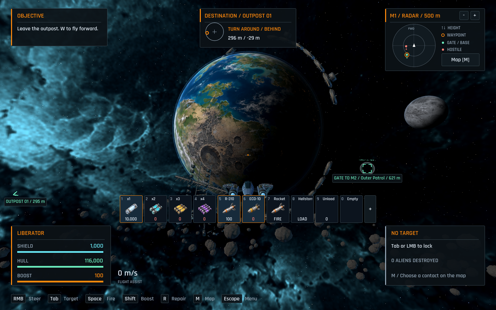

# Reclamation campaign backgrounds

The four maps implement the [approved campaign concepts](../../art/map-background-concepts/README.md) as 3D scenery. This quality pass replaces the first implementation's coarse planetary noise and soft nebula with dedicated surface textures, larger planetary compositions, layered metal structures and denser debris belts. M1 shows the aftermath of the invasion and returning human supply staging. The outer sectors show alien resource extraction and salvage among former human infrastructure. Planets, moons, ruined rings, collectors, receivers, wrecks and belts have real spatial depth; the nebula surrounds the pilot in every direction.

## In-game views

These captures use the actual sector, Compatibility renderer and behind-the-ship camera at 1440 x 900. The HUD is hidden in the gallery to expose the scenery; corresponding HUD views are linked below.

For comparison, the [previous M1 implementation](https://github.com/Timerk/Dorbit/blob/1d7e50e7358d6370cef735ecb129c7efb29356ad/docs/sector-art/campaign-m1-background.png) used the coarse procedural surface and sparse scenery. The current captures below come from the final textured version.


HUD views: [M1](campaign-m1-flight.png), [M2](campaign-m2-flight.png), [M3](campaign-m3-flight.png) and [M4](campaign-m4-flight.png).

M1's follow-up revision makes the previous war visible on the planet itself:
large impact basins interrupt ruined city districts and severed roads. The
damaged continent faces the light in the normal flight view. Oceans, healthy
terrain and cloud cover preserve the colony's habitable character.



## Implementation and limits

[SectorBackdrop](../../scripts/sector_backdrop.gd) builds each map's distant scenery and switches its nebula palette and stellar lighting on arrival. Human and alien model components merge by material. Beveled armor, exposed carrier ribs and decks, layered ring modules, broken defense frames and alien processing throats give the landmarks recognizable silhouettes. Each distant belt uses three MultiMeshes with 480 varied rocks; scattered human hull plates frame the battlefield.

The [sky shader](../../shaders/space.gdshader) samples a dedicated nebula panorama at screen resolution, preserves dark flight space and blends its spherical seam. The [planet shader](../../shaders/planet.gdshader) wraps surface textures with coherent coastlines, geology, settlements, damage and mines, then adds the terminator, surviving lights and collector excavation. A thin [atmosphere shell](../../shaders/atmosphere.gdshader) extends beyond the solid limb. [Mining streams](../../shaders/mining_stream.gdshader) animate in the material without particle simulation or networking. The [texture sources and exact prompts](../../assets/sector/campaign-textures.md) document the generated original artwork.

All decorative geometry stays outside the 1,200 m flight boundary. It has no colliders, services or navigation contacts. Client and server retain identical physics envelopes for all 96 playable asteroids and the 53 station boxes. The outer maps now use the existing textured rock models inside those envelopes. The camera far plane extends to 8,500 m to retain distant landmarks from across the sector.

The scenery depicts a fixed post-arrival M1 and occupied outer sectors. It does not implement mining interactions, campaign missions, changing occupation states or construction stages. Existing station and ship models remain in use. The concept paintings remain references; new generated textures contain only sky or surfaces. Orbital objects, rocks, wrecks and planets are real meshes. The colony's cloud pattern is baked into its surface texture and does not animate.

## Validation

- The Windows suite passed all 52 check invocations. It includes dedicated-server combat, connected-map travel, stale-packet isolation, persistence, collision geometry, targeting, autopilot, HUD, settings and the hunt/repair replay. Existing ObjectDB cleanup warnings remain in some fixtures.
- The final sector visual fixture passed 430 headless assertions. It compares all four maps' client/server obstacles, checks background bounds and surface resources, verifies palette changes and repeated visits, and confirms the dedicated server creates no rendering. It also checks that the revised war texture and burned-city light suppression apply only to M1.
- The user-reported collinear-target/up-vector warning was reproduced in alien steering. Near vertical headings, aliens now carry their current roll through the pole and choose an independent up axis when needed. The new steering fixture passes 32 assertions covering straight up/down, near-vertical flight, pole crossings, ordinary world-up leveling and coincident destinations. Its pre-fix run produced the warning and a roll-flip failure; its corrected run has neither.
- The rendered sector fixture completed without script or shader errors. It captured station approaches, ordinary flight, planet-facing views, reverse views and near-boundary views on all four maps, with the default Compatibility renderer, 4x MSAA and bloom off.
- The Windows resource pack exported successfully. The same four-map fixture ran against the packaged resources using an external review script, exercising dynamically loaded textures, geometry and shaders. A new standalone Windows executable was not built during this refinement pass.
- The [raw frame report](campaign-render-report.json) records 120 frames per boundary view and 240 frames of home flight on an AMD Radeon(TM) Graphics adapter at 1440 x 900, 4x MSAA and VSync off. These short single-client samples do not establish ten-player rendering performance; the report records the actual timings rather than an FPS guarantee.

## Reproduce

Run validation sequentially with a disposable profile. This preserves player preferences and keeps renderer workloads out of network admission timing.

```powershell
$env:APPDATA = Join-Path $PWD 'build/backdrop-review-profile'
rtk proxy powershell -ExecutionPolicy Bypass -File tools/dev.ps1 check
rtk proxy .tools/godot/Godot_v4.7.2-stable_win64_console.exe --path . --script res://tests/sector_art_preview.gd
rtk proxy powershell -ExecutionPolicy Bypass -File tools/dev.ps1 build
```

The preview writes captures and the frame report to `build/validation/sector-art`. The render fixture launches the offline development encounter and then visits the four map backgrounds. Headless checks do not test the final appearance.
