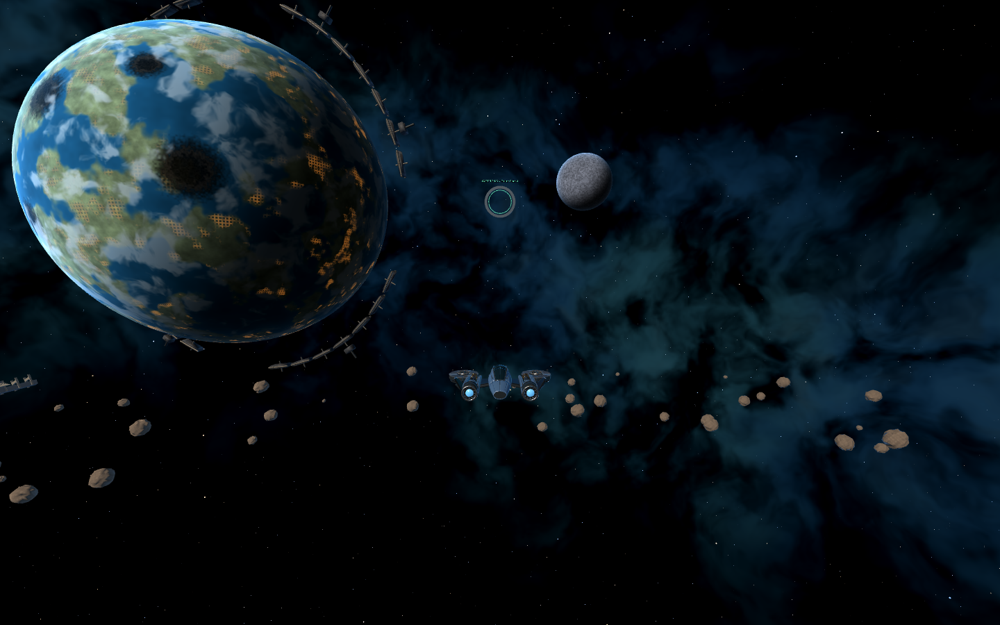
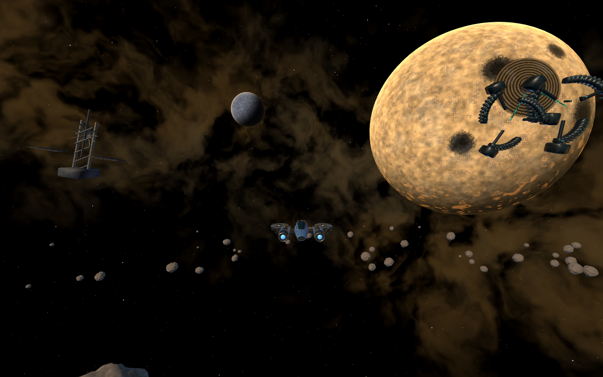
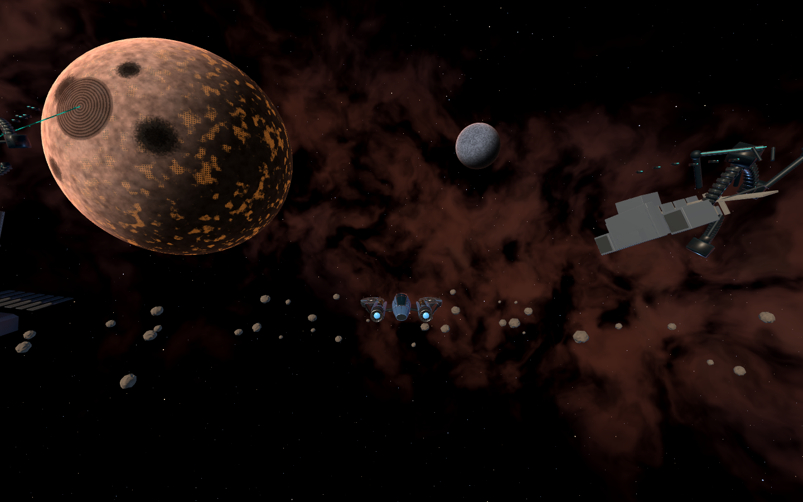
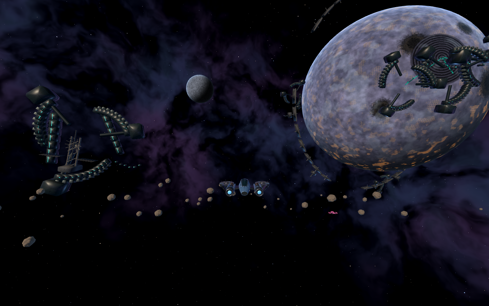

# Reclamation campaign backgrounds

The four maps now implement the [approved campaign concepts](../../art/map-background-concepts/README.md) as 3D scenery. M1 shows the aftermath of the invasion and returning human supply staging. The outer sectors show alien resource extraction and salvage among former human infrastructure. Planets, moons, ruined rings, collectors, receivers, wrecks and belts have real spatial depth; the nebula surrounds the pilot in every direction.

## In-game views

These captures use the actual sector, Compatibility renderer and behind-the-ship camera at 1440 x 900. The HUD is hidden in the gallery to expose the scenery; corresponding HUD views are linked below.









HUD views: [M1](campaign-m1-flight.png), [M2](campaign-m2-flight.png), [M3](campaign-m3-flight.png) and [M4](campaign-m4-flight.png).

## Implementation and limits

[SectorBackdrop](../../scripts/sector_backdrop.gd) builds each map's distant scenery and switches its nebula palette on arrival. Human and alien model components merge by material. Each distant belt uses three MultiMeshes. The [planet shader](../../shaders/planet.gdshader) draws terrain, ruined settlement grids, bombardment damage, cloud cover, atmosphere and terraced mines. [Mining streams](../../shaders/mining_stream.gdshader) animate in the material without particle simulation or networking.

All decorative geometry stays outside the 1,200 m flight boundary. It has no colliders, services or navigation contacts. Client and server retain identical physics envelopes for all 96 playable asteroids and the 53 station boxes. The outer maps now use the existing textured rock models inside those envelopes. The camera far plane extends to 8,500 m to retain distant landmarks from across the sector.

The scenery depicts a fixed post-arrival M1 and occupied outer sectors. It does not implement mining interactions, campaign missions, changing occupation states or construction stages. Existing station and ship models remain in use. The generated concepts guided the composition and story; the runtime uses procedural geometry and shaders rather than the paintings as flat backgrounds.

## Validation

- The Windows suite passed all 51 check invocations. It includes dedicated-server combat, connected-map travel, stale-packet isolation, persistence, collision geometry, targeting, autopilot, HUD, settings and the hunt/repair replay.
- The expanded sector visual fixture passed 359 headless assertions. It compares all four maps' client/server obstacles, checks background bounds, verifies palette changes and repeated visits, and confirms the dedicated server creates no rendering.
- The rendered sector fixture completed without script or shader errors. It captured station approaches, ordinary flight, planet-facing views, reverse views and near-boundary views on all four maps.
- The Windows export passed, including packaged asset/menu checks and matching source/export protocol fingerprints. The four-map render fixture also completed against the exported pack, so dynamic scenery and shader resources were exercised outside the source project.
- A separate rendered run of the visual assertions passed 935 assertions, including the GPU-backed instanced belt transforms. On shutdown it reported GL texture cleanup errors. The previous, unmodified visual-test fixture also reports GL texture cleanup errors when run with a renderer. The normal sector preview completed without these shutdown errors.
- Local samples on an AMD Radeon RX 6800 at 1440 x 900, 4x MSAA and VSync off measured approximately 1.69-1.83 ms average frame intervals and 1.86-2.22 ms p95 in the four boundary views. The home flight sample averaged approximately 489 FPS with 2.21 ms p95. These short, single-client samples do not establish laptop performance or a ten-player rendering budget. See the [raw report](campaign-render-report.json).

## Reproduce

Run validation sequentially with a disposable profile. This preserves player preferences and keeps renderer workloads out of network admission timing.

```powershell
$env:APPDATA = Join-Path $PWD 'build/backdrop-review-profile'
rtk proxy powershell -ExecutionPolicy Bypass -File tools/dev.ps1 check
rtk proxy .tools/godot/Godot_v4.7.2-stable_win64_console.exe --path . --script res://tests/sector_art_preview.gd
rtk proxy powershell -ExecutionPolicy Bypass -File tools/dev.ps1 build
```

The preview writes captures and the frame report to `build/validation/sector-art`. The render fixture launches the offline development encounter and then visits the four map backgrounds. Headless checks do not test the final appearance.
